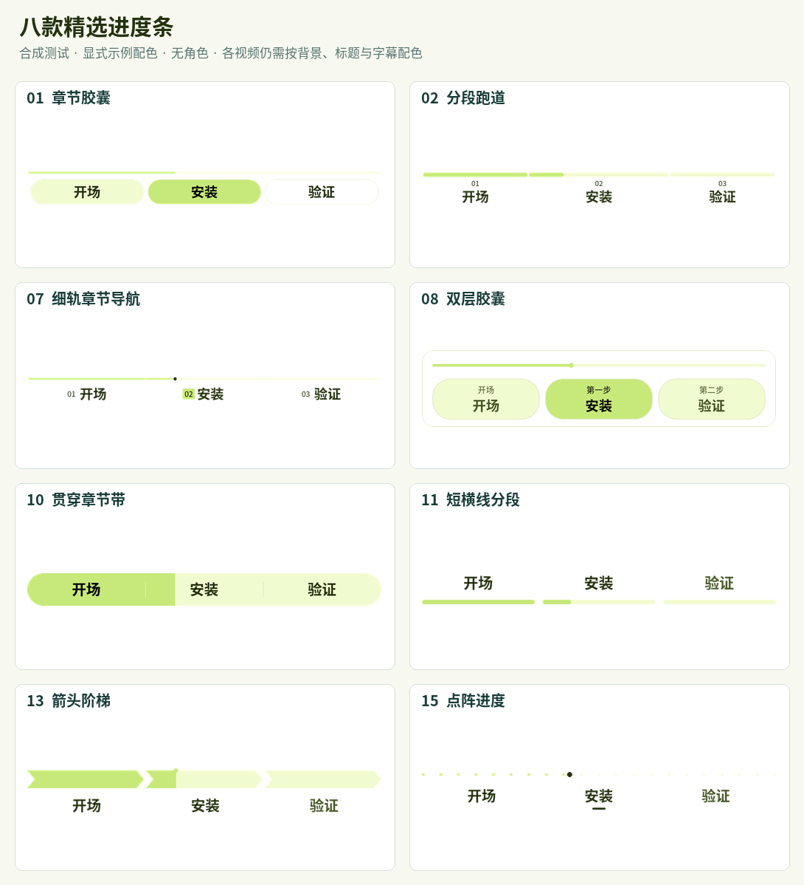

# ElleFlow｜小人走路视频进度条动画

<p align="center">
  
</p>

<p align="center">
  把剪好的视频拖进来，按内容整理章节，选择纯进度条或四帧 IP 行走，生成独立透明 MOV。已保存的角色与视觉方案，下次可以直接复用。
</p>

<p align="center">
  <a href="#一分钟开始">一分钟开始</a> · <a href="#你会拿到什么">你会拿到什么</a> · <a href="#四种常用说法">四种常用说法</a> · <a href="#常见问题">常见问题</a> · <a href="#维护与技术信息">维护与技术信息</a>
</p>

---

## 让懒人无痛拥有视频章节进度条

做视频时，想加一个会推进的章节条，往往得反复听视频、卡时间、调关键帧。ElleFlow 先根据当前成片整理语义章节，再把角色、样式和配色做成高清透明进度条。宿主没有带时间转写能力时，可以使用同一成片的 SRT/VTT；角色生图也按宿主实际能力接力。

最后把透明进度条拖回原来的高清剪映工程，从视频开头对齐即可。原片不需要来回上传、下载或重新合成。

## 一分钟开始

### 1. 安装

把下面这段话发给你正在使用的 Agent：

```text
请帮我安装这个 Skill：
https://github.com/hututu-ai/progress-bar-studio

安装 skill/progress-bar-studio，并告诉我怎样开始使用。
```

安装完成后，重新打开 Agent 或新建一个任务。

### 2. 上传成片，先选有无 IP

直接上传已经剪好的视频，并告诉 Agent：“使用我的 IP”或“不加角色”。也可以先说“让我看看样式”。不加角色时会跳过角色读取和生图；有 IP 时使用四帧行走。

可读取的成片不需要因为清晰度高而重新导出。文件过大时可以使用 `720p` 分析副本，但它必须和原工程保持相同的时长、画面顺序和播放速度。

### 3. 看一次完整动态方案

Agent 会合并展示章节、角色、样式、配色、尺寸和体积估计。首次或改动方案先给标明“待审”的动态草稿，你可以一次确认设计、短样和完整导出，也可以只改不满意的部分。

一开始已说清楚的选择不会重复询问。例如：“快速模式，沿用上次的角色和粉色，08 双层胶囊，2K。”Agent 仍会重新核对当前视频的章节与画面适配；改颜色不需要重做角色。

### 4. 第二条视频可以整套沿用

完成并保存过一次方案后，下一条视频会先出现一个不占步骤的“快捷设置”，显示上次确认的
**角色、精确样式、配色、大小和位置**。选择“整套沿用”后，这些内容不会
再逐项询问；ElleFlow 会重新分析新视频的章节和画面适配，并继续做预览与导出检查。

新项目默认 4 章，按内容调整为 3–5 章，最多 5 章。同一用法的案例、操作细节和前后对比优先合并，不按时长平均切分。新视频不会继承旧视频的时间点。

---

## 你会拿到什么

你真正需要拿回剪辑软件的是这一份：

| 主交付物 | 你拿它做什么 |
| --- | --- |
| `progress_bar.mov` | 高清透明进度条母版，拖进剪映、PR、Final Cut 等软件，叠加到你的高清原视频上 |

`sample_progress_bar.mov`、章节记录、角色素材和透明检查记录属于 ElleFlow 项目的过程资料：它们会在项目中保留，方便修改、复用和排查，但不会被当成一堆需要你处理的“最终文件”。

ElleFlow 不会替你重导整条原片。高清原视频一直留在你的剪辑工程里，透明进度条才是可复用、可调整、最省上传时间的交付物。

## 制作流程

五个内部阶段会合并成“上传素材 → 看一次动态方案 → 收到透明成品”。已有答案和授权不重复询问。

| 阶段 | Agent 会做什么 | 你需要提供什么 |
| --- | --- | --- |
| 1. 复用与预检 | 检查已有方案、依赖和宿主能力 | 成片、有无 IP；有记录时可直接沿用 |
| 2. 语义分章 | 按完整主题分为 3–5 章，核对原话与切点 | 仅补充确实不清楚的边界；无转写时提供同片字幕 |
| 3. 设计 | 从八款样式或参考图建立方案，检查真实画面中的比例 | 选择样式、配色、清晰度，或委托 Agent 按视频设计 |
| 4. 角色 | 复用已批准四帧，或根据宿主能力准备新四帧 | 新角色原图与必要生图授权；无 IP 跳过 |
| 5. 审阅与交付 | 合并动态审阅，导出透明 MOV、检查 Alpha | 一次确认或提出修改；可同时决定是否保存方案 |

## 四种常用说法

### 只有视频

```text
给这个视频做进度条。
先把内容拆成章节给我确认，确认后再做后面的设计。
```

### 视频加角色图

```text
给这个视频做进度条。
章节确认后，让这张角色图沿进度条走起来；先给我看走路形象。
```

### 做极简纯进度条

```text
分析这个视频的章节，不使用角色。
做一条简洁的文字进度条，颜色用 #E89AB3。
```

### 明确要叠回高清原片

```text
这是我的 720p 分析版。请按它的章节和时长做一条 2K 透明进度条，
我会拖回原来的高清剪映工程里使用。
```

## 八款精选样式

| 样式 | 更适合什么视频 |
| --- | --- |
| **01 章节胶囊** | 章名醒目，适合知识讲解与课程 |
| **02 分段跑道** | 按实际时长分段，保留已讲过的章节 |
| **07 细轨章节导航** | 连续细轨与完整章名，视觉更轻 |
| **08 双层胶囊** | 上小下大的两层标题，适合观点与步骤 |
| **10 贯穿章节带** | 连贯横向叙事 |
| **11 短横线分段** | 短横线与章名一一对应 |
| **13 箭头阶梯** | 有明确先后关系的教程 |
| **15 点阵进度** | 轻量、疏朗的进度表达 |

编号保持兼容，不按顺序重新编号。图册青柠色只是示例；实际配色可以指定、沿用，或结合当前视频画面设计。

还可以直接上传你喜欢的进度条截图。ElleFlow 会提取它的轨道、标签和层级逻辑，不会把低清截图直接放大当成成品，也不会保留第三方 Logo、水印或角色。

## 常见问题

### 必须上传 720p 吗？

不需要。已有可读取成片可以直接用；文件太大时再提供 `720p` 分析副本。进度条会在实际视频帧上检查位置和可读性，最终仍交付独立透明条，不重编码整条原片。

### 480p 可以吗？

可以。视频特别长或网络较慢时，`480p` 也能用于大多数口播、Vlog 和知识内容的章节整理。涉及屏幕录制、小字 PPT、代码或表格时，建议使用 `720p`；如果仍看不清，ElleFlow 会请你补一张清晰截图或章节名称，而不是让你默认上传整条高清原片。

### 高清原片后来又剪了几秒，还能直接叠加吗？

不建议。分析版和高清原片必须保持相同的时长、画面比例和播放速度。若后面删改了片段、变速或重新排序，请从更新后的工程再导出一份分析版，避免章节时间点错位。

### 没有角色图，也能做吗？

可以。选择“不使用角色”，就会得到纯章节进度条；也可以后续再补一张角色图。

### 我能把自己常用的角色、样式和配色保存下来吗？

可以。ElleFlow 会先询问是否保存预设；样片确认通过、完整进度条开始导出后，
才把角色、精确样式、配色、大小和位置一起保存到本地。走路角色会保存完整的
四帧透明步态，不会只存一张图。下次会先出现“快捷设置”；确认沿用后不再重复
询问这些字段。视频、章节、输出清晰度、输出文件夹和导出授权不会被保存。

### 我能选清晰度吗？

可以。项目的默认条宽为 `1080p=1920`、`2K=2160`、`4K=3840` 像素，也保留明确指定的像素宽度。它们是透明条宽度，放进竖屏或横屏工程时会按实际画面检查缩放。理论体积区间不保证上限，应以实际短样校准。

### 它会不会直接开始渲染，浪费时间和额度？

已有选择和授权会连续使用，不反复确认。新方案先给最长 15 秒的待审动态草稿，完整导出需要本轮授权；生图额度另行明确。草稿、体积估算和保存过的角色都不会自动变成新视频的批准记录。

---

## 手动安装

如果你的 Agent 不支持自动安装，可以先下载仓库：

```bash
git clone https://github.com/hututu-ai/progress-bar-studio.git
cd progress-bar-studio
```

再把 `skill/progress-bar-studio` 复制到你的 Agent 技能目录：

| Agent | 常见全局目录 |
| --- | --- |
| Codex | `~/.codex/skills/` |
| Claude Code | `~/.claude/skills/` |
| Cursor | `~/.cursor/skills/` |
| GitHub Copilot | `~/.copilot/skills/` |

例如 Codex：

```bash
mkdir -p ~/.codex/skills
cp -R skill/progress-bar-studio ~/.codex/skills/
```

不同 Agent 的安装目录可能随版本调整；安装后只要目标目录中有 `SKILL.md`、`assets/`、`references/` 和 `scripts/` 即可。

<details>
<summary><strong>维护与技术信息</strong></summary>

### 运行条件

- `ffmpeg` 与 `ffprobe`：探测分析视频、生成样片、导出透明 MOV。
- Python 3：运行检查、预设和交付脚本。
- Pillow：四帧行走素材和 WebP 预览。
- 宿主提供的转写与图像编辑能力：用于自动分章和角色处理。

在开始媒体处理前，可运行预检：

```bash
python3 skill/progress-bar-studio/scripts/preflight.py \
  --source-video /path/to/analysis-video.mp4 \
  --output-dir /path/to/output \
  --json
```

它会检查 FFmpeg、ProRes 4444 编码器、Pillow、分析视频、目标文件夹和磁盘空间。转写、图像编辑和剪辑软件导入能力由正在使用的 Agent 与本机软件决定。

### 本地验证

```bash
python3 -m pip install Pillow
python3 -m unittest discover -s tests -v
```

测试会生成临时短视频，覆盖无音频提示、竖屏探测、损坏媒体、不可写输出目录、磁盘不足、透明 Alpha 校验、同名任务版本化、无角色路径和可复用预设。GitHub Actions 会在推送到 `main` 或提交 Pull Request 时运行同一套检查。

### 项目结构

```text
progress-bar-studio/
├── README.md
├── CHANGELOG.md
├── LICENSE
├── .github/workflows/validate.yml
├── tests/
└── skill/progress-bar-studio/
    ├── SKILL.md
    ├── agents/openai.yaml
    ├── assets/
    ├── references/
    └── scripts/
```

### 许可证

本项目采用 [MIT License](LICENSE)，可使用、修改和分发，但须保留许可证与版权声明。

</details>
